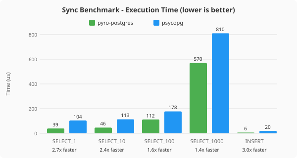

# pyro-postgres

A high-performance PostgresQL driver for Python, backed by Rust.

- [Documentation](https://elbaro.github.io/pyro-postgres/)
- [Benchmarks](https://github.com/elbaro/pyro-postgres/tree/main/benchmark)

## License

Licensed under the [Blue Oak Model License 1.0.0](https://blueoakcouncil.org/license/1.0.0).

By submitting a pull request, you agree that your contribution is licensed under the Blue Oak Model License 1.0.0. You also grant the project maintainer a perpetual, worldwide, non-exclusive, royalty-free, irrevocable license to use, modify, sublicense, and relicense your contribution under any other terms. You keep the copyright to your contribution, and you confirm that you have the right to submit it under these terms.
